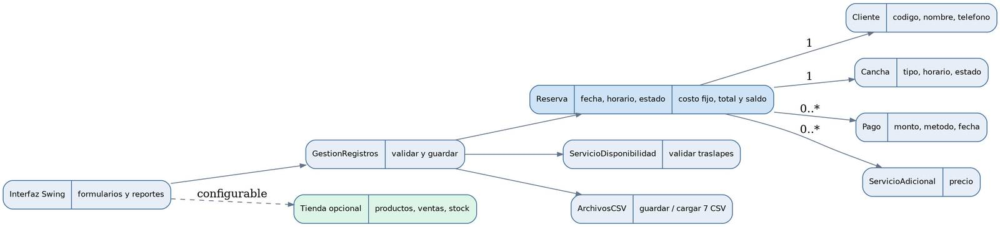
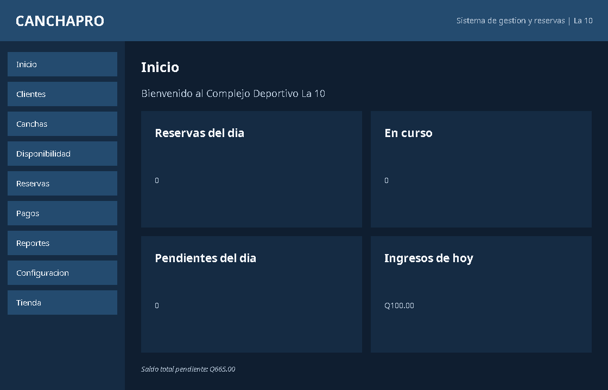
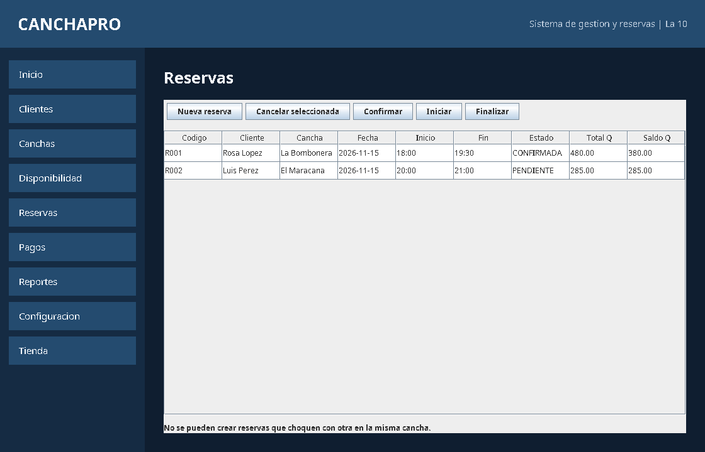
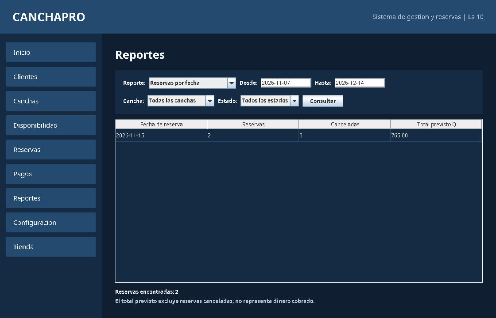
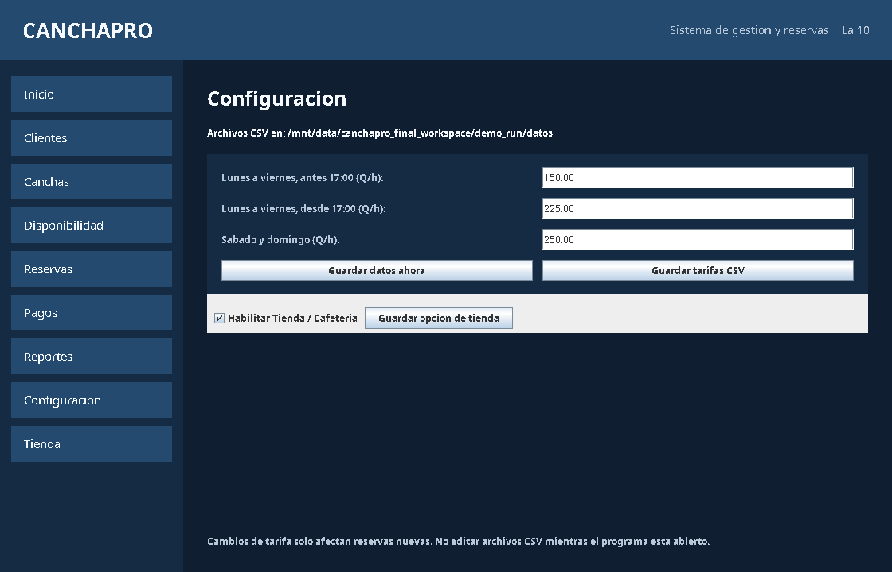
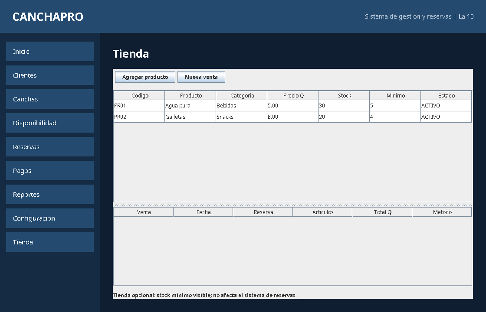

# CanchaPro

**Sistema de Gestión y Reservas para Complejos Deportivos**  
**Proyecto Final — Programación 2**  
**Ingeniería en Sistemas — Universidad Mariano Gálvez de Guatemala**  
**Caso de estudio:** Complejo Deportivo ficticio "La 10"  
**Versión:** entrega final, 14 de noviembre de 2026

## 1. Introducción

En algunos complejos deportivos las reservas se anotan por mensajes, llamadas y cuadernos. Esto puede causar confusiones de horario, pérdida de anticipos y dificultad para conocer las ventas del negocio. Para este proyecto se desarrolló CanchaPro, una aplicación de escritorio que organiza clientes, canchas, reservas y pagos. El sistema sigue el enfoque de Programación Orientada a Objetos en Java y guarda la información en archivos de texto CSV, sin utilizar base de datos.

## 2. Objetivo general

Desarrollar un sistema funcional para administrar reservas de canchas deportivas, consultar disponibilidad, controlar pagos y emitir reportes utilizando clases, colecciones, validaciones, archivos e interfaz gráfica.

## 3. Objetivos específicos

- Modelar el negocio con clases y relaciones correctas.
- Evitar reservas de una misma cancha con horarios traslapados.
- Calcular tarifas y saldos automáticamente.
- Guardar y recuperar la información sin usar base de datos.
- Elaborar reportes útiles para la administración.
- Mantener independiente el módulo adicional Tienda/Cafetería.
- Probar el funcionamiento con escenarios válidos e inválidos.

## 4. Tecnologías

| Herramienta | Uso |
| --- | --- |
| Java 17 | Lógica y programación orientada a objetos |
| Apache NetBeans | Edición, compilación y ejecución del proyecto |
| Swing | Ventanas, botones, formularios y tablas |
| Maven | Organización y generación del JAR |
| CSV UTF-8 | Persistencia de datos sin base de datos |
| PlantUML | Diagrama de clases |

## 5. Estructura y diseño orientado a objetos

Las entidades principales del núcleo son `Cliente`, `Cancha`, `Reserva`, `Pago` y `ServicioAdicional`. Cada reserva mantiene referencias a su cliente y cancha, además de colecciones de servicios y pagos. Los datos en memoria se reúnen en `DatosSistema`. Los formularios delegan las validaciones en las clases de servicio en lugar de escribir directamente líneas CSV.



El archivo `diagrama_clases.puml` presenta la versión detallada del UML con atributos, métodos, relaciones, multiplicidades y enumeraciones. La aplicación utiliza encapsulamiento, composición y herencia de Swing cuando corresponde.

## 6. Módulos desarrollados

| Módulo | Funcionamiento |
| --- | --- |
| Inicio | Dashboard con reservas del día, en curso, pendientes e ingresos |
| Clientes | Registro, búsqueda y modificación |
| Canchas | Datos, tipos, horarios, capacidad y estado |
| Disponibilidad | Consulta automática según fecha, hora, duración y tipo |
| Reservas | Creación completa, estados válidos y cancelaciones |
| Tarifas | Configuración CSV con precios históricos por reserva |
| Servicios y pagos | Servicios opcionales, anticipos, abonos y saldo |
| Persistencia | Carga y reconstrucción de objetos desde archivos |
| Reportes | Ocho informes con filtros y operaciones de agrupación |
| Tienda opcional | Productos, inventario, ventas y stock mínimo |

## 7. Regla de disponibilidad

Dos reservas de la misma cancha se consideran traslapadas si se cumple simultáneamente:

```
inicioNuevo < finExistente
Y
finNuevo > inicioExistente
```

Ejemplo: si una reserva ocupa 18:00–19:30, otra a las 19:00 sería rechazada en esa cancha. Una nueva reserva que inicie exactamente a las 19:30 puede aceptarse si no coincide con ninguna otra. Se rechazan también canchas en mantenimiento, inactivas o fuera del horario de atención.

## 8. Flujo de reserva y cálculo

1. Seleccionar cliente registrado.
2. Ingresar fecha, hora y duración.
3. Consultar la disponibilidad automática y elegir una cancha libre.
4. Agregar servicios adicionales y calcular el precio.
5. Registrar anticipo opcional con método de pago.
6. Confirmar, guardar y consultar el saldo.

Una reserva puede pasar de `PENDIENTE` a `CONFIRMADA`, luego a `EN_CURSO` y después a `FINALIZADA`. Se puede cancelar una reserva pendiente o confirmada, conservando motivo, responsable y fecha de cancelación.

El costo de alquiler usa la tarifa correspondiente a la hora inicial de la reserva, según el nivel medio del enunciado. Las tarifas iniciales son Q150/h diurna, Q225/h nocturna y Q250/h los fines de semana. Se configuran desde la aplicación en `tarifas.csv`. Para que una modificación de tarifas no cambie registros anteriores, `Reserva` conserva el costo histórico al momento de su creación.

```
Total = Costo de cancha + Servicios
Saldo = Total - Pagos registrados
```

Se utiliza `BigDecimal` para manejar los montos de dinero y comprobar anticipos y pagos múltiples.

## 9. Persistencia

El sistema guarda los objetos del núcleo en estos archivos:

| Archivo | Contenido |
| --- | --- |
| `clientes.csv` | Datos de los clientes |
| `canchas.csv` | Datos y estados de canchas |
| `servicios.csv` | Catálogo de servicios |
| `tarifas.csv` | Tarifas configurables |
| `reservas.csv` | Reservas, estados e importes históricos |
| `reserva_servicios.csv` | Servicios agregados por reserva |
| `pagos.csv` | Historial de pagos y métodos |

La carpeta `datos/` se genera en la primera ejecución. Al iniciar de nuevo se reconstruyen las relaciones entre los objetos. Se validan formatos, encabezados y referencias. Para proteger datos de errores de escritura se usan archivos temporales y reemplazo de cada CSV; sin embargo, **no existe una transacción atómica conjunta** entre todos los archivos. Se recomienda respaldar toda la carpeta con el programa cerrado.

## 10. Reportes

Los ocho reportes son reservas por fecha, reservas por cancha, ingresos por período, pagos pendientes, reservas canceladas, cancha más utilizada, horas de mayor demanda y clientes frecuentes. La clase `ServicioReportes` agrupa, cuenta, suma, compara y filtra. Los ingresos se calculan por **fecha de cobro**, y los informes de demanda excluyen reservas canceladas.

## 11. Tienda/Cafetería

El módulo es opcional y se habilita mediante `modulo_tienda=true` en `configuracion.properties`, que puede cambiarse en la pantalla Configuración sin recompilar. Se pueden agregar productos y realizar ventas de uno o varios artículos. Cada venta reduce las existencias; si la cantidad solicitada supera el stock, el programa rechaza la operación. Una venta puede estar asociada opcionalmente a una reserva, sin que esta asociación sea necesaria para el núcleo.

La tienda utiliza `productos.csv`, `ventas.csv` y `detalle_ventas.csv`. Sus archivos y objetos son independientes de los de reservas. Se muestra advertencia cuando el stock llega a su mínimo.

## 12. Evidencia visual

### 12.1 Dashboard



### 12.2 Reservas



### 12.3 Reportes



### 12.4 Configuración y tarifas



### 12.5 Tienda opcional



## 13. Pruebas y resultados

Se compilaron todas las clases con **Java `--release 17`** y se ejecutaron once grupos de pruebas, incluyendo navegación Swing en un entorno gráfico:

| Archivo de prueba | Casos correctos |
| --- | ---: |
| `PruebasDisponibilidad` | 19 |
| `PruebasPagos` | 26 |
| `PruebasArchivosCSV` | 25 |
| `PruebasFormularios` | 25 |
| `PruebasReportes` | 38 |
| `PruebasFlujoReserva` | 43 |
| `PruebasTarifasDashboard` | 11 |
| `PruebasTienda` | 24 |
| `PruebasInterfaz` | 5 |
| `PruebasInterfazReportes` | 3 |
| `PruebasInterfazTienda` | 3 |
| **TOTAL** | **222** |

Los resultados se incluyen como evidencia en `documentacion/resultado_pruebas.txt`. Estos resultados corresponden a la revisión automatizada realizada en el entorno de desarrollo; deben repetirse en la computadora de entrega.

## 14. Manuales y entregables

Se adjunta el código fuente, UML, datos de demostración, manual de usuario, manual técnico, archivo JAR y el presente documento. El proyecto se puede abrir desde NetBeans o ejecutar con Java 17 o superior.

## 15. Limitaciones

- No se realiza copia de seguridad automática: el respaldo de `datos/` debe hacerse manualmente.
- El sistema no procesa devoluciones automáticas por cancelación.
- Los pagos son registros administrativos, no cargos bancarios reales.
- No utiliza base de datos ni autenticación, conforme al alcance del proyecto académico.
- Se adopta la tarifa por hora de inicio, no la división avanzada por tramos.
- Los CSV no cuentan con transacciones conjuntas como una base de datos.

## 16. Conclusiones

CanchaPro permite aplicar la Programación Orientada a Objetos a un problema concreto: evita reservas incompatibles, calcula importes y saldos, conserva registros y genera reportes a partir de objetos relacionados. Los resultados de las pruebas permiten demostrar reglas de negocio, validaciones, manejo de errores y persistencia. La separación entre interfaz, servicios y archivos facilita explicar el código y realizar modificaciones pequeñas durante la defensa. La tienda adicional puede activarse o desactivarse sin afectar el núcleo obligatorio de reservas.
