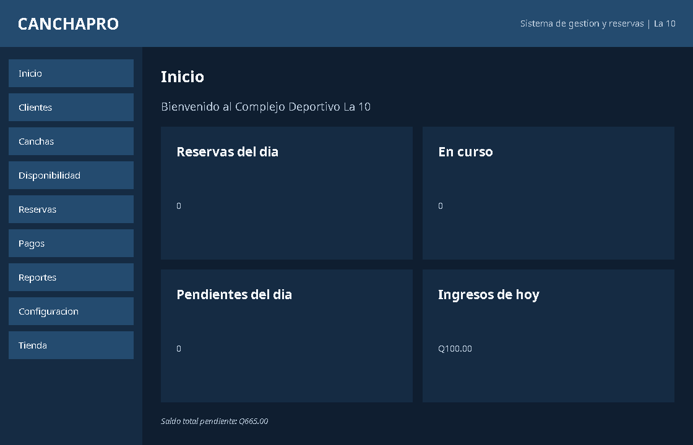
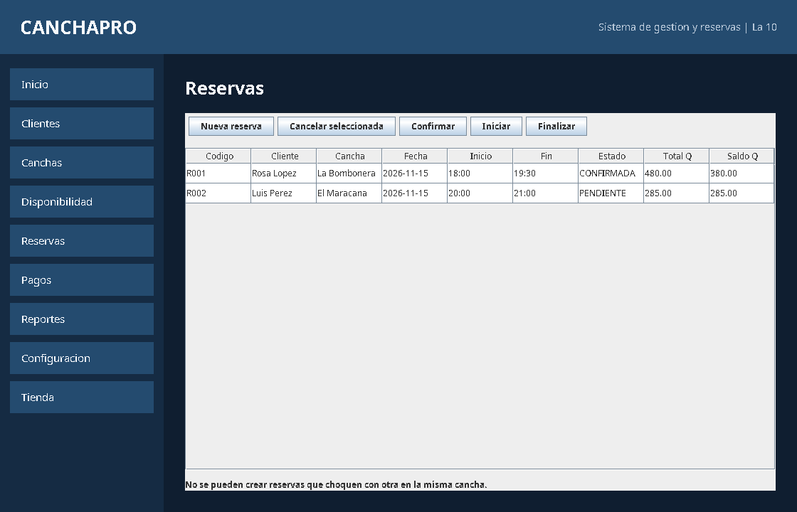
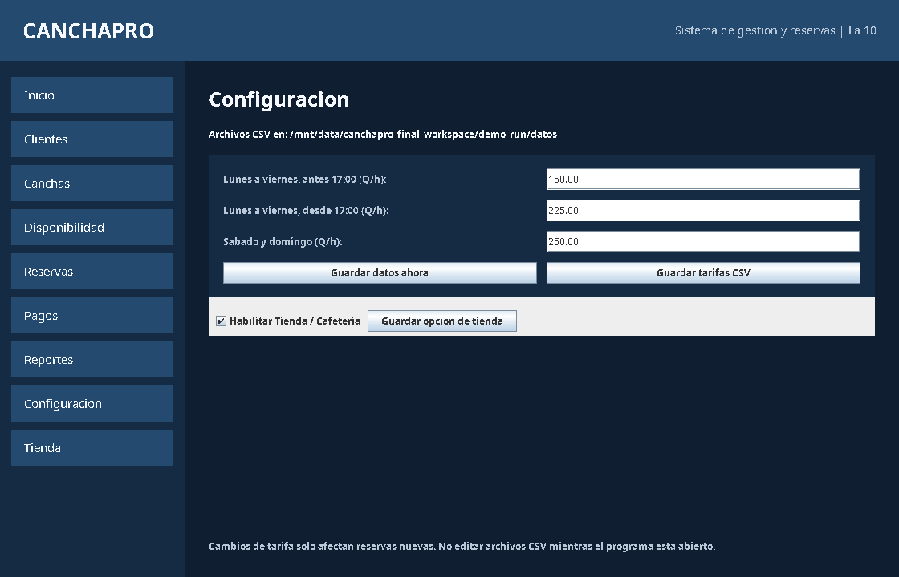
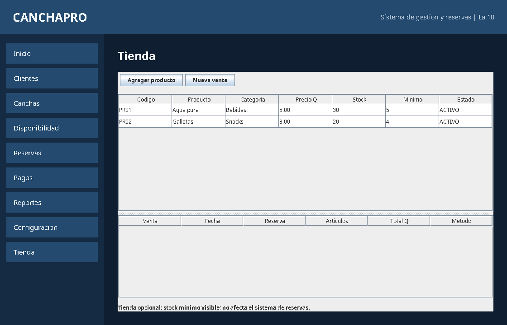
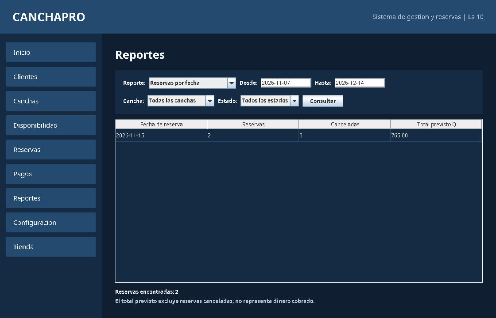

# Manual de Usuario — CanchaPro

**Proyecto final de Programación 2** · Complejo Deportivo "La 10" · Versión final de entrega (noviembre de 2026)

## 1. ¿Qué hace el programa?

CanchaPro permite organizar canchas deportivas, clientes, horarios, reservas, servicios y pagos. Incluye reportes de ingresos y demanda, y una tienda opcional. Es una aplicación de escritorio, por lo que no necesita internet ni una base de datos.

## 2. Abrir CanchaPro

1. Instalar **JDK 17 o superior** y **Apache NetBeans**.
2. Descargar el proyecto y descomprimirlo.
3. Abrir la carpeta que tiene `pom.xml` desde **Archivo > Abrir proyecto**.
4. Buscar `Main.java` y elegir **Run File**, o ejecutar el proyecto.

También puede abrirse con el JAR suministrado, usando Java 17 o superior. La carpeta `datos/` se crea junto al directorio desde el que se ejecuta el programa; en **Configuración** aparece la ruta exacta.

## 3. Panel principal

En **Inicio** se ven datos reales del sistema:

- **Reservas del día:** reservas de la fecha actual que no están canceladas.
- **En curso:** reservas de hoy con estado `EN_CURSO`.
- **Pendientes del día:** reservas de hoy con estado `PENDIENTE`.
- **Ingresos de hoy:** suma de abonos cobrados hoy, aunque sean de partidos futuros.
- **Saldo pendiente:** suma de saldos de reservas no canceladas.

El menú también contiene Clientes, Canchas, Disponibilidad, Reservas, Pagos, Reportes, Configuración y, cuando se activa, Tienda.

## 4. Clientes

En **Clientes** pulsar **Agregar cliente**, llenar código, nombre, teléfono y correo opcional, y confirmar. Para encontrarlo, escribir su código, nombre o teléfono y pulsar **Buscar**. Para modificar un registro, seleccionar la fila y usar **Editar seleccionado**. Se evitan códigos o teléfonos repetidos.

## 5. Canchas

En **Canchas** usar **Agregar cancha** e ingresar código, nombre, tipo, capacidad, precio base, horario de apertura/cierre y estado. Los estados disponibles son `DISPONIBLE`, `MANTENIMIENTO` e `INACTIVA`. Para suspender una cancha, seleccionar su fila y elegir **Cambiar estado**. Una cancha en mantenimiento o inactiva no aparece como disponible para nuevas reservas.

## 6. Consultar horarios

En **Disponibilidad** indicar fecha (`AAAA-MM-DD`), hora (`HH:mm`), duración y tipo de cancha. Presionar **Consultar**. El sistema muestra únicamente canchas libres; rechaza traslapes, canchas fuera de servicio y horarios fuera de apertura. Dos reservas pueden tocarse exactamente en la hora de terminación e inicio sin conflicto.

## 7. Crear la reserva completa

1. Entrar a **Reservas** y pulsar **Nueva reserva**.
2. Indicar código, cliente, fecha, hora y duración.
3. Elegir tipo de cancha y presionar **Buscar canchas libres**.
4. Seleccionar una cancha del resultado.
5. Marcar servicios adicionales si se necesitan (Ctrl para varios).
6. Pulsar **Calcular total** para revisar el importe.
7. Ingresar un anticipo opcional y su método de pago.
8. Aceptar. Se guarda la reserva **CONFIRMADA** con el total y saldo.

En la tabla de Reservas se puede **Confirmar** una pendiente, **Iniciar** una confirmada, **Finalizar** una en curso o **Cancelar** una pendiente/confirmada. Para cancelar debe indicarse motivo y responsable. No se borra el registro del historial.

## 8. Cobrar otros abonos

En **Pagos** seleccionar la reserva, escribir el monto y el método y pulsar **Registrar abono**. También se pueden agregar servicios **antes del primer pago**. La tabla muestra costo de cancha, servicios, total, pagado y saldo.

No se aceptan montos negativos, cero ni mayores que el saldo. Cancelar una reserva no realiza devoluciones automáticamente.

## 9. Configurar tarifas y Tienda

En **Configuración** se pueden cambiar las tres tarifas generales y guardarlas en `datos/tarifas.csv`:

| Condición | Tarifa inicial |
| --- | ---: |
| Lunes a viernes antes de 17:00 | Q150/h |
| Lunes a viernes desde 17:00 | Q225/h |
| Sábado y domingo | Q250/h |

Los cambios **solo afectan reservas creadas después del cambio**: los importes anteriores siguen intactos. Se usa la tarifa de la hora inicial cuando una reserva cruza dos franjas.

Para usar la Tienda, marcar **Habilitar Tienda / Cafetería** y presionar **Guardar opción de tienda**. Aparecerá el botón Tienda. Se puede desactivar del mismo modo sin borrar el inventario.

## 10. Tienda/Cafetería (opcional)

Al entrar a **Tienda**, presionar **Agregar producto** para crear un producto con código, nombre, categoría, precio, existencia y stock mínimo. Presionar **Nueva venta** para seleccionar uno o varios productos (Ctrl), especificar la cantidad de cada uno, elegir forma de pago y opcionalmente indicar el código de reserva asociada. La venta disminuye el inventario automáticamente.

No es posible vender más unidades que las disponibles. La tabla muestra ventas e importes, y el indicador **STOCK BAJO** cuando se alcanza o baja del mínimo.

## 11. Reportes

En **Reportes** elegir uno de los ocho informes y aplicar rango de fechas y filtros de cancha/estado:

1. Reservas por fecha.
2. Reservas por cancha.
3. Ingresos por período.
4. Pagos pendientes.
5. Reservas canceladas.
6. Cancha más utilizada.
7. Horarios de mayor demanda.
8. Clientes con más reservas.

Los ingresos se cuentan por **fecha de cobro**, no por fecha del partido. Los reportes de demanda excluyen reservas canceladas.

## 12. Cerrar, respaldar y restaurar

Los cambios se guardan en CSV. Para hacer un respaldo, **cerrar el sistema** y copiar completa la carpeta `datos/` a una memoria USB u otra carpeta. Para restaurar, cerrar el programa, sustituir `datos/` con el respaldo y abrirlo nuevamente. No editar manualmente los CSV mientras CanchaPro esté ejecutándose.

Si se detecta una línea corrupta o falta alguno de los archivos principales, el programa mostrará un mensaje de error en lugar de reemplazarlos silenciosamente.

## 13. Solución de problemas

| Problema | Qué revisar |
| --- | --- |
| No inicia en NetBeans | JDK 17+, `pom.xml` y carpeta abierta correctamente |
| Fecha u hora inválida | Usar `AAAA-MM-DD` y `HH:mm` |
| No aparece cancha | Estado, tipo, horario y traslapes |
| Reserva no permitida | Código repetido, horario ocupado o cancha en mantenimiento |
| Pago rechazado | Monto positivo y no superior al saldo |
| Venta rechazada | Producto activo, cantidades válidas y stock disponible |
| Error de CSV | Restaurar una copia completa de `datos/` |

**Importante:** CanchaPro es un proyecto académico; no incorpora autenticación, pagos bancarios en línea, facturación electrónica ni copias automáticas.
